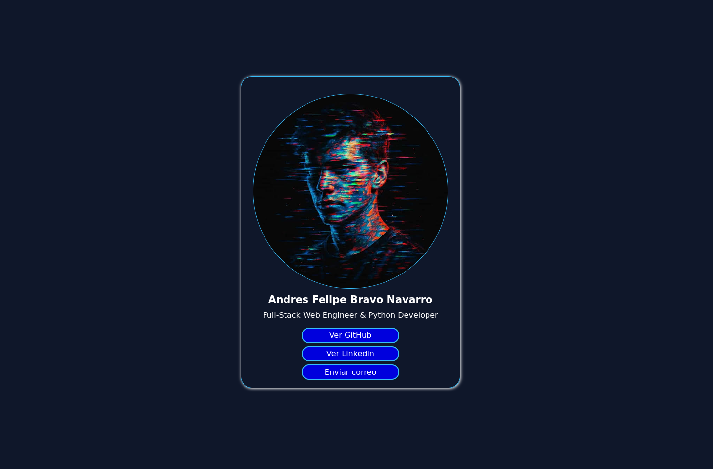
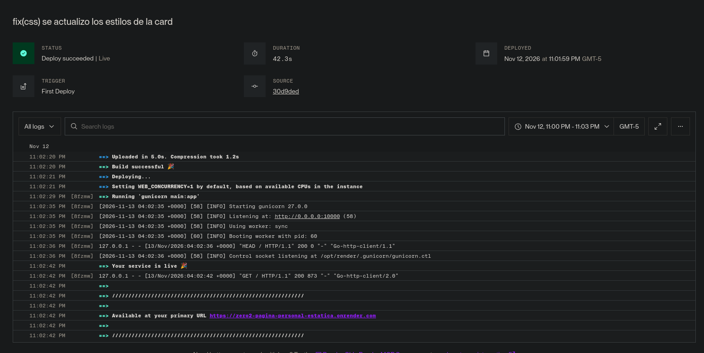

# [Nivel 2] Pagina personal estatica

Una aplicación web muy básica construida con Flask que muestra una tarjeta de presentacion con datos personales y enlaces a redes. Este es el proyecto #2 del roadmap de 100 proyectos web en Python.

🔗 **[Ver proyecto en vivo aquí](https://zero2-pagina-personal-estatica.onrender.com/)**

## Capturas de pantalla

1. **Vista principal:**


2. **Terminal local:**


3. **Despliegue en Render:**


## Stack utilizado
* Python 3
* Flask
* Gunicorn (para producción)

## Pasos de ejecución local

Si deseas correr este proyecto en tu máquina, sigue estos pasos:

1. Clona el repositorio:
   ```bash
   git clone [https://github.com/Andres-Developer-23/01-hola-mundo.git](https://github.com/Andres-Developer-23/01-hola-mundo.git)
   cd 01-hola-mundo